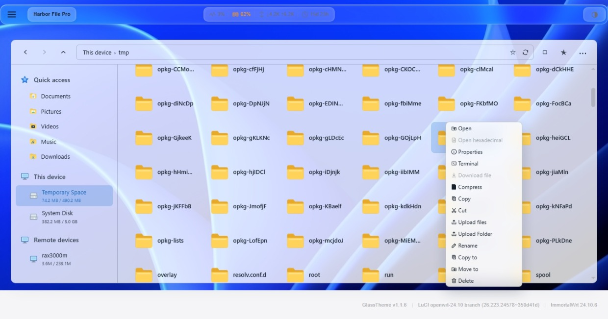
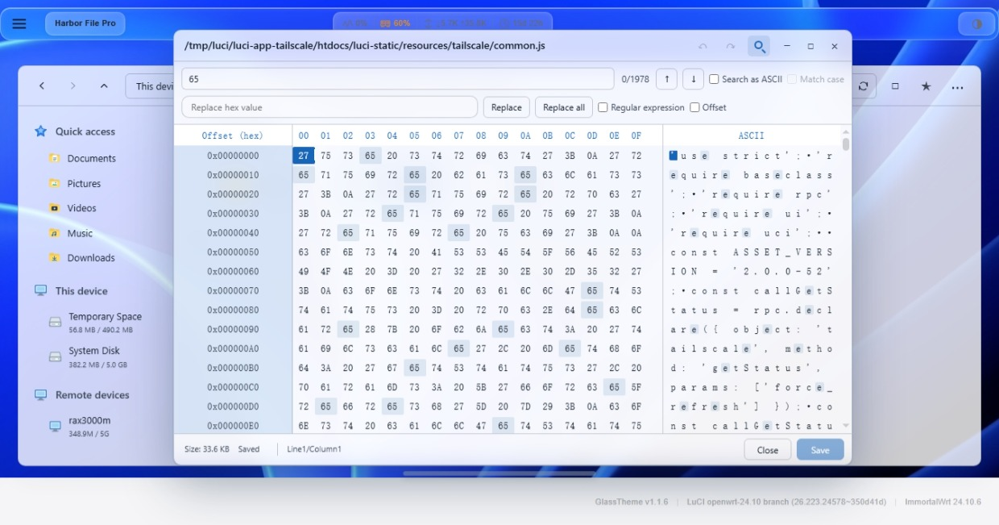
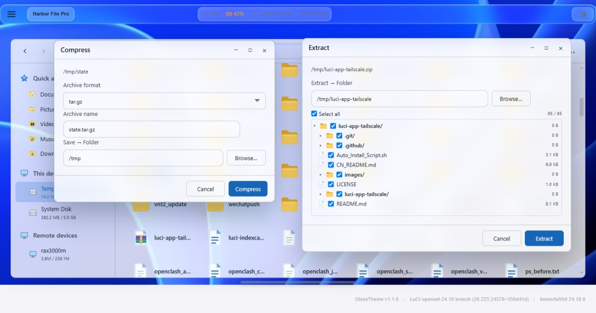
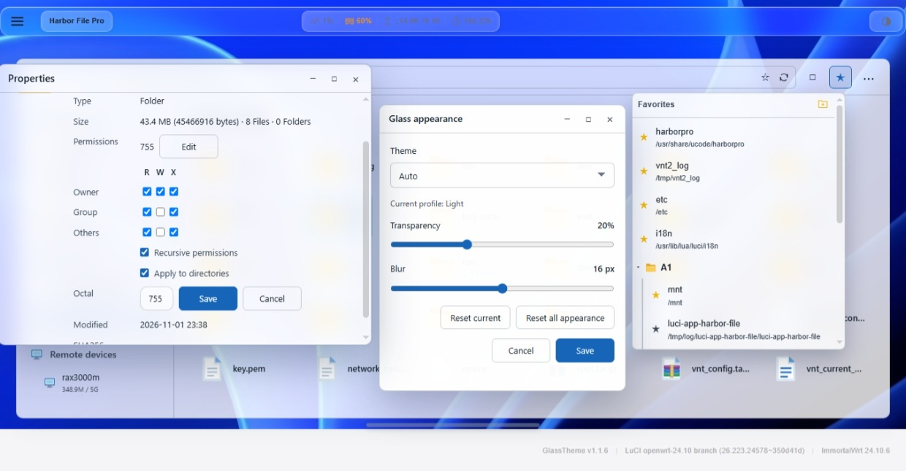
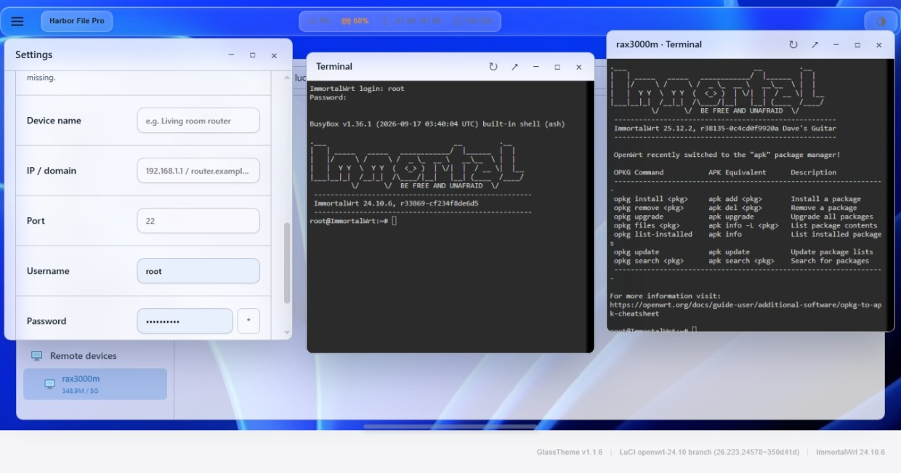
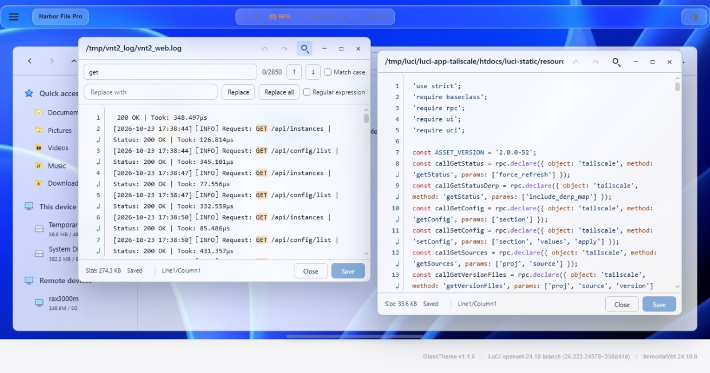
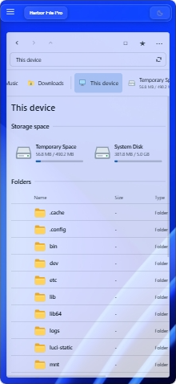
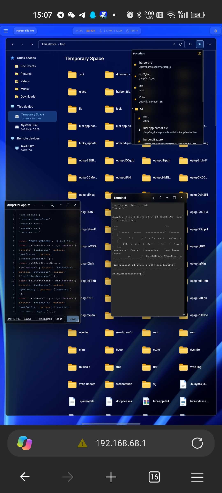

# Harbor File Pro
[**English**](./README.md) | 简体中文

**OpenWrt 上真正能当“桌面级文件管理器”用的 LuCI 插件。**  

Harbor File Pro 把文件管理推向了新高度。原版Harbor File做到了能用，Harbor File Pro 做到了好用、功能与操作体验以及视觉体验精细到头发丝。

> 无大小限制的文本/Hex 编辑 · 多终端保活与远程设备互连 · 深度解压/压缩增强 · 任务栏多窗口 · 收藏夹 · 权限可视化 · 完美适配移动端。



---

在保留原版所有功能的基础上，完成了**代码重构**和**数十项实用新功能**。因多次提交未获上游合并，遂独立为 **Pro 版**。  
**性能更优、操作更顺、视觉更佳、功能更强、多端适配** —— 这就是 Pro 带给你的全新体验 。

---

## 🚀 核心独有功能（与原版的差异）

### 1. 十六进制编辑器：1TB 文件不卡，浏览器不冻结
原版 Hex 只能“看”，且无法打开大文件。Pro 把 Hex 编辑器做成了**专业级修改工具**。
- **大文件零压力**：打开 **1TB 或 10TB 文件与 1KB 文件同样流畅**，不卡顿，大二进制文件操作绝对不触发 OOM（内存溢出），浏览器不卡死。
- **正则查找替换**：支持正则表达式、区分大小写，显示匹配位置与数量，结果高亮，支持 Replace / Replace All。
- **双视图同步**：Hex 视图（00–0F）与 ASCII 视图同时显示，点击任一侧，**另一侧同步高亮对应位置**。
- **支持撤销 / 重做 + 异常恢复**：意外关闭后可恢复未保存修改。



### 2. 解压与压缩：能力全面碾压原版
原版解压能力非常基础，Pro 在**格式支持、路径控制、冲突处理、批量操作**四个维度全面扩展：
- **解压增强**：可像 WinRAR 一样预览文件，选择指定文件解压，**解压前可选择目标路径**（面包屑跳转或手动输入）；同名文件提示覆盖，绝不静默覆盖或直接失败；长路径下保留空白可点击区域，防止无法输入路径。
- **压缩增强**：**压缩时可选择输出路径**；目标文件已存在时提示覆盖；**修复覆盖文件夹时丢失已有文件的问题**，支持解压更多格式。
- **粘贴冲突三选一**：同名文件可选 **覆盖 / 重命名（自动加序号）/ 跳过**，原版无此冲突决策机制。


### 3. 文件操作与权限管理：同样精细到头发丝
原版无权限编辑，Pro 增加了**权限编辑，递归范围控制**和**可视化双模式**。
- **权限可视化**：文件/文件夹属性页直接勾选读/写/执行，也可手动输入 `755` 等数字。
- **高级递归权限**：可区分“仅对文件生效”或“对目录及文件生效”，只改普通文件而保持目录权限不变。
- **目录上传与统计**：支持直接上传整个文件夹；属性页显示目录占用大小、子目录数量、文件数量。
- **细节体验**：覆盖文件时保留原始权限；支持直接输入重命名；支持“替换文件”功能；移动/复制时可手动输入目标路径。
- **卸载清理**：卸载插件时自动清理残留文件。



### 4. 远程设备互连与多终端管理
这是原版完全没有的跨设备工作流：
- **文件枢纽中心**：对远程设备进行操作与本机操作完全一致，做到了一端安装，全端受益。
- **跨设备互连**：将远程 OpenWrt 设备的文件系统当作本地目录操作，支持跨设备复制/粘贴/移动/剪切。
- **sha256 安全校验**：跨设备剪切/移动时，先做 `sha256sum` 校验，**通过后才删除源文件**，防止传输丢失。
- **终端多开与保活**：支持同时打开多个终端（本地/远程），最小化窗口**保留连接**（点击 X 才销毁）；支持一键刷新重连、外链新页面打开。



### 5. 文本编辑器：不丢数据，代码高亮
- **无文件大小限制**：文本文件一样流畅，浏览器不冻结。
- **专业级搜索**：大小写敏感、匹配计数、高亮定位、Replace / Replace All / 上下个。
- **数据安全**：**撤销/重做**，意外关闭自动询问恢复未保存修改。
- **代码高亮**：Prism 语法高亮并支持在线更新，自动清理 U+200B 零宽空格。



### 6. 桌面级窗口交互与界面
- **窗口多开与任务栏**：自由缩放/最大化/最小化，窗口尺寸记忆；任务栏在桌面底部左/中/右任意位置均可呼出，**闲置 3 秒自动隐藏**；窗口切换逻辑贴合 Windows（点击非活动窗口置前，点当前窗口最小化）。
- **收藏夹**：收藏当前路径，支持**命名、新建文件夹、移动、删除**。
- **Win11 同款主题**：支持深色/浅色主题，支持自动根据浏览器切换，支持自定义透明度和磨砂效果，适配第三方主题（测试主题：`luci-theme-glass`、`aurora`、`Argon`）；屏幕铺满开关；错误提示改为 Windows 风格弹窗。

### 7. 移动端触屏全面适配
不是把桌面布局缩小，而是触屏逻辑全面编写适配：
- 单击打开，长按出菜单；长按拖拽移动，支持多选批量拖拽。
- 拖到页面边缘自动滚动；勾选文件时页面自动滚到顶部/底部。
- 你以为这就完了; 手机浏览器设置为桌面模式同样做了适配。

<p align="center">
    
</p>

### 8. 其他效率工具
- **地址栏点击输入**：点击空白区域直接键入路径（桌面/移动端均可）。
- **依赖安装闭环**：使用功能 -> 自动查依赖 -> 提示安装到**正确设备** -> 装完继续原操作，无需手动重试。

---

## 📦 安装与兼容性

### 一键安装（推荐）

使用 curl 或 wget 执行以下命令：

**使用 curl:**
```bash
curl -fsSL "https://gitlab.com/whzhni/tailscale/-/raw/main/Auto_Install_Script.sh" | sh -s luci-app-harbor-file-pro
```

**使用 wget:**
```bash
wget -q -O - "https://gitlab.com/whzhni/tailscale/-/raw/main/Auto_Install_Script.sh" | sh -s luci-app-harbor-file-pro
```

或从 [Releases](https://github.com/whzhni1/luci-app-harbor-file-pro/releases) 下载 `.ipk` / `.apk` 手动安装。

> **兼容性**：可与原版 `luci-app-harbor-file` 同时安装，不冲突。

---

## 许可与致谢

基于 [destan19/luci-app-harbor-file](https://github.com/destan19/luci-app-harbor-file) 深度重构与扩展，遵循原项目许可。感谢原作者的出色基础工作。
##  Harbor File Pro始于原版超越原版

