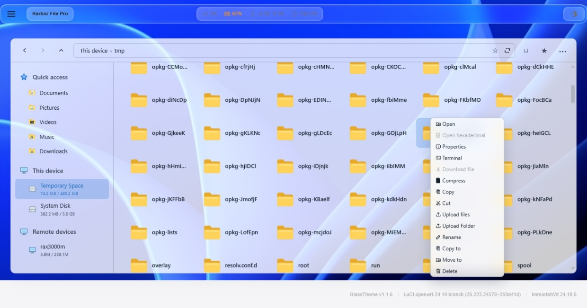
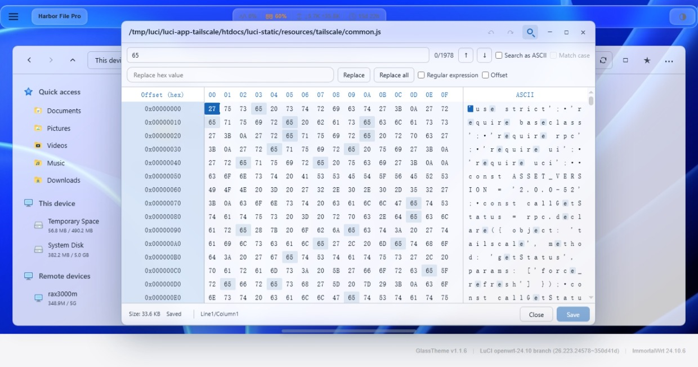
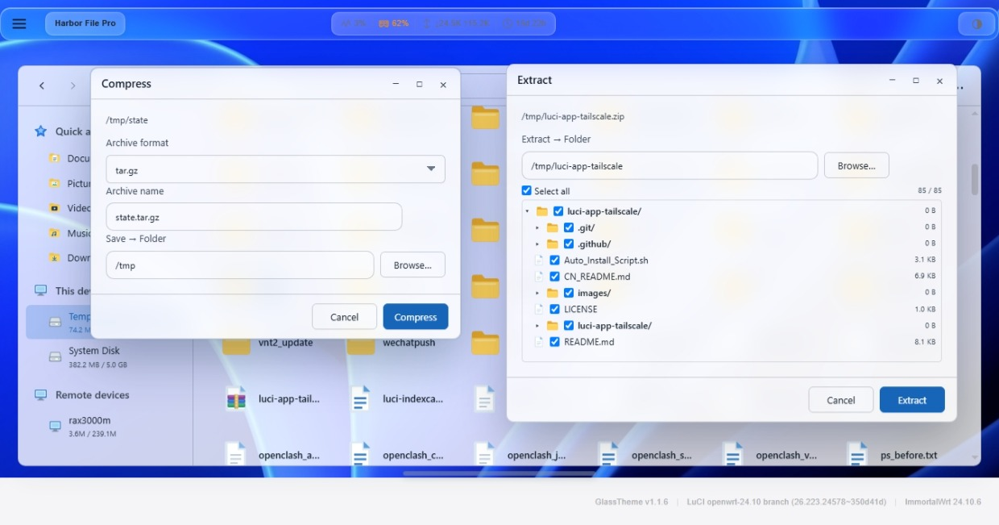
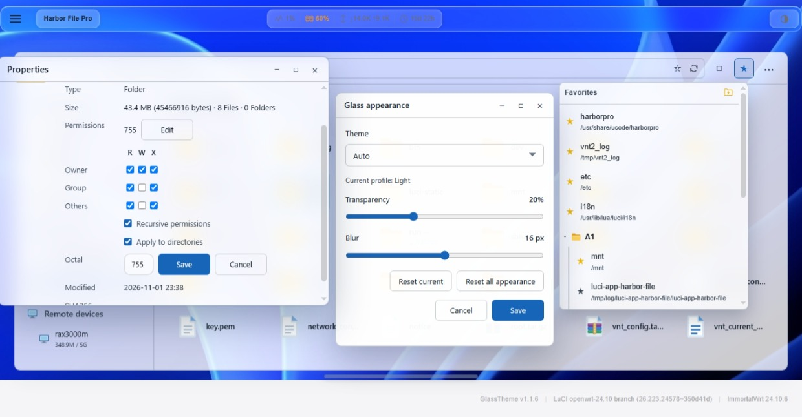
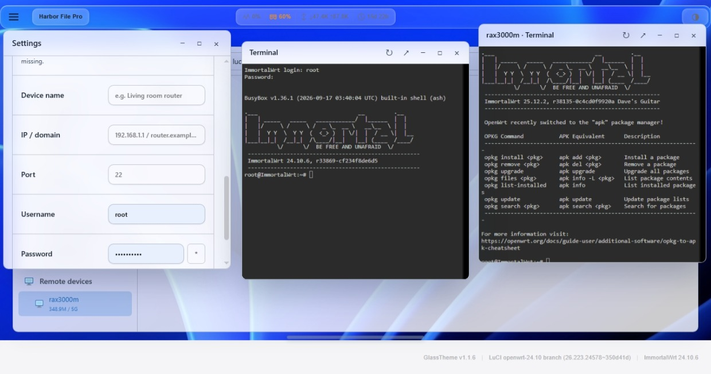
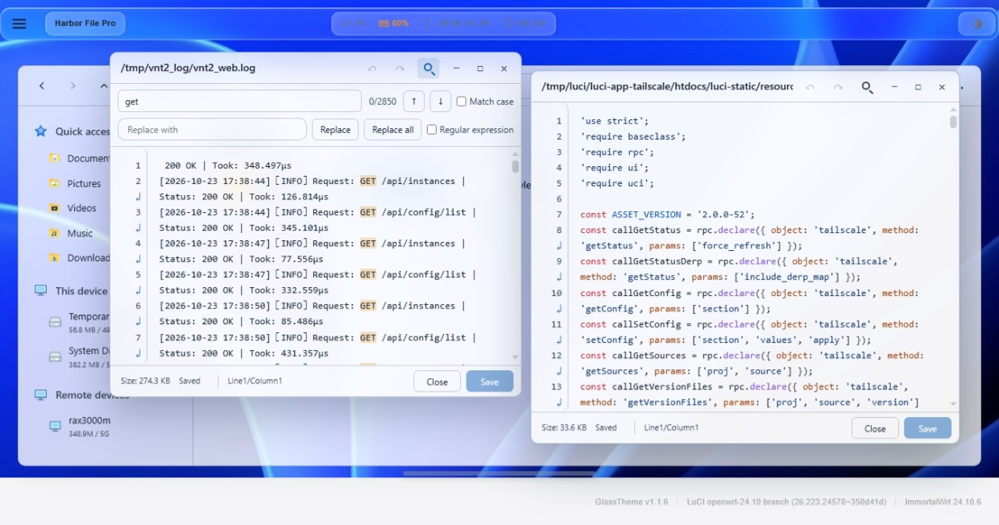
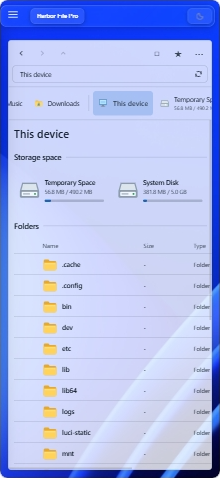
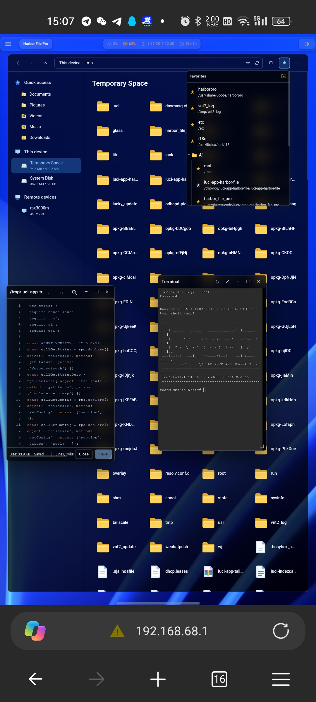

# Harbor File Pro
[**简体中文**](./CN_README.md) | English

**A LuCI plugin for OpenWrt that can truly be used as a desktop-class file manager.**

Harbor File Pro takes file management to a new level. The original Harbor File made it usable; Harbor File Pro makes it good to use—features, operation experience, and visual experience are refined to the finest detail.

> Unlimited-size text/Hex editing · Multi-terminal keep-alive and remote device interconnection · Enhanced extraction/compression · Taskbar multi-window · Favorites · Permission visualization · Full mobile adaptation.



---

While retaining all original features, it has completed a **code refactor** and **dozens of practical new features**. Because multiple submissions were not merged upstream, it was released independently as the **Pro version**.  
**Better performance, smoother operation, better visuals, stronger features, and multi-device adaptation** — this is the all-new experience Pro brings you.

---

## 🚀 Core Unique Features (Differences from the Original)

### 1. Hex Editor: 1TB Files Without Lag, Browser Without Freezing
The original Hex editor could only “view” and could not open large files. Pro turns the Hex editor into a **professional-grade modification tool**.
- **Zero pressure with large files**: Opening a **1TB or 10TB file is as smooth as opening a 1KB file**, with no lag. Operations on large binary files absolutely do not trigger OOM (out of memory), and the browser does not freeze.
- **Regex find and replace**: Supports regular expressions and case sensitivity, displays match positions and count, highlights results, and supports Replace / Replace All.
- **Synchronized dual views**: Hex view (00–0F) and ASCII view are displayed simultaneously; clicking either side **synchronously highlights the corresponding position on the other side**.
- **Undo / redo + exception recovery**: Unsaved changes can be recovered after an accidental close.



### 2. Extraction and Compression: Comprehensive Capabilities That Outperform the Original
The original extraction capability is very basic. Pro comprehensively expands in **four dimensions: format support, path control, conflict handling, and batch operations**:
- **Extraction enhancements**: Preview files like WinRAR, select specific files to extract, and **choose the target path before extraction** (breadcrumb navigation or manual input); prompt before overwriting same-name files, never silently overwrite or fail directly; under long paths, retain blank clickable areas to prevent inability to enter a path.
- **Compression enhancements**: **Choose the output path when compressing**; prompt to overwrite when the target file already exists; **fix the issue of losing existing files when overwriting folders**; support more extraction formats.
- **Three paste conflict options**: For same-name files, choose **Overwrite / Rename (auto-numbered) / Skip**. The original has no such conflict decision mechanism.


### 3. File Operations and Permission Management: Equally Refined to the Finest Detail
The original has no permission editing. Pro adds **permission editing, recursive scope control**, and a **visual dual mode**.
- **Permission visualization**: Check read/write/execute directly on the file/folder properties page, or manually enter numbers such as `755`.
- **Advanced recursive permissions**: Distinguish “**apply only to files**” or “**apply to directories and files**,” changing only regular files while keeping directory permissions unchanged.
- **Directory upload and statistics**: Upload an entire folder directly; the properties page shows directory size, subdirectory count, and file count.
- **Detail experience**: Preserve original permissions when overwriting files; support direct rename input; support the “replace file” function; manually enter the target path when moving/copying.
- **Uninstall cleanup**: Automatically clean up residual files when uninstalling the plugin.



### 4. Remote Device Interconnection and Multi-Terminal Management
This is a cross-device workflow completely absent from the original:
- **File hub center**: Operations on remote devices are exactly the same as local operations—install on one end, benefit on all ends.
- **Cross-device interconnection**: Treat the file system of a remote OpenWrt device as a local directory, supporting cross-device copy/paste/move/cut.
- **sha256 security verification**: When cutting/moving across devices, run `sha256sum` verification first and **delete the source file only after it passes**, preventing transfer loss.
- **Multi-terminal and keep-alive**: Open multiple terminals simultaneously (local/remote); minimizing a window **retains the connection** (only clicking X destroys it); support one-click refresh and reconnect, and opening external links in a new page.



### 5. Text Editor: No Data Loss, Code Highlighting
- **No file size limit**: Text files are equally smooth, and the browser does not freeze.
- **Professional-grade search**: Case sensitivity, match count, highlighted positioning, Replace / Replace All / previous and next.
- **Data safety**: **Undo/redo**; after an accidental close, automatically ask whether to recover unsaved changes.
- **Code highlighting**: Prism syntax highlighting with online updates, and automatic cleanup of U+200B zero-width spaces.



### 6. Desktop-Class Window Interaction and Interface
- **Multi-window and taskbar**: Freely resize/maximize/minimize, with window size memory; the taskbar can be summoned at any position—left/center/right—at the bottom of the desktop, and **auto-hides after 3 seconds idle**; window switching logic follows Windows (click an inactive window to bring it to the front; click the current window to minimize it).
- **Favorites**: Favorite the current path, with support for **naming, creating folders, moving, and deleting**.
- **Win11-style theme**: Supports dark/light themes, automatic switching based on the browser, custom transparency and frosted glass effects, and adaptation to third-party themes (tested themes: `luci-theme-glass`, `aurora`, `Argon`); screen-fill toggle; error prompts changed to Windows-style popups.

### 7. Full Touchscreen Adaptation for Mobile
It is not about shrinking the desktop layout; the touch logic has been fully written and adapted:
- Tap to open, long-press for menu; long-press and drag to move, with multi-select batch dragging.
- Dragging to the page edge auto-scrolls; when selecting files, the page automatically scrolls to the top/bottom.
- And that’s not all; it is also adapted when the mobile browser is set to desktop mode.

<p align="center">
    
</p>

### 8. Other Efficiency Tools
- **Address bar click-to-input**: Click a blank area to directly type a path (works on desktop and mobile).
- **Dependency installation loop**: Use a feature -> automatically check dependencies -> prompt to install on the **correct device** -> continue the original operation after installation, with no manual retry.

---

## 📦 Installation and Compatibility

### One-Click Installation (Recommended)

Use curl or wget to execute the following command:

**Using curl:**
```bash
curl -fsSL "https://gitlab.com/whzhni/tailscale/-/raw/main/Auto_Install_Script.sh" | sh -s luci-app-harbor-file-pro
```

**Using wget:**
```bash
wget -q -O - "https://gitlab.com/whzhni/tailscale/-/raw/main/Auto_Install_Script.sh" | sh -s luci-app-harbor-file-pro
```

Or download the `.ipk` / `.apk` from [Releases](https://github.com/whzhni1/luci-app-harbor-file-pro/releases) for manual installation.

> **Compatibility**: Can be installed alongside the original `luci-app-harbor-file` without conflict.

---

## License and Acknowledgements

Based on deep refactoring and extension of [destan19/luci-app-harbor-file](https://github.com/destan19/luci-app-harbor-file), following the original project license. Thanks to the original author for the excellent foundational work.
## Harbor File Pro: Started from the Original, Surpassing the Original
